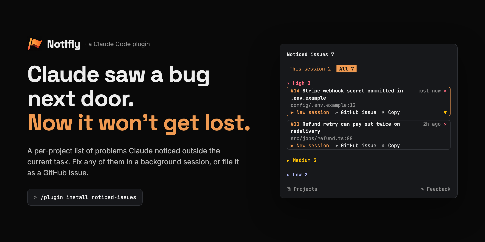
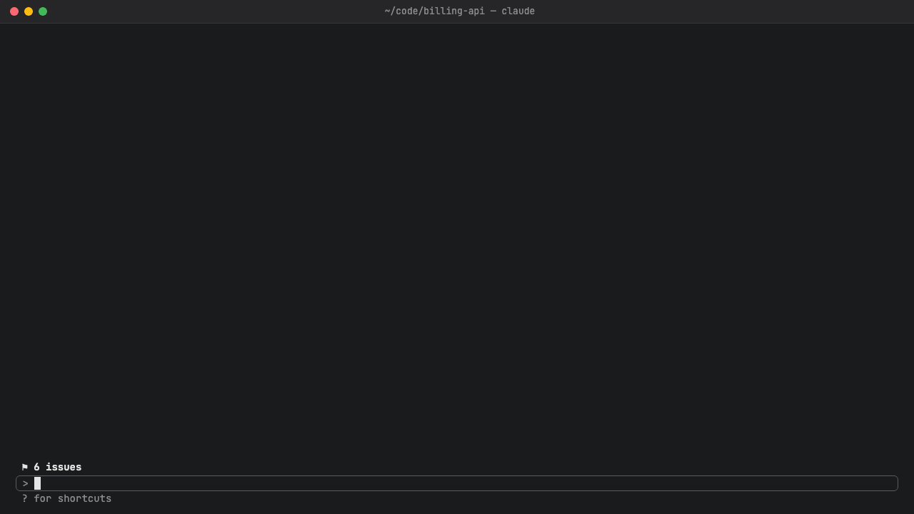

<p align="center"></p>

# Noticely

Noticely is a Claude Code plugin that keeps a per-project list of problems Claude noticed
**outside the current task** and is not fixing right now: a bug next door, a leaked
secret, broken config, a failing check, stale docs. Instead of getting lost in the
conversation, each finding goes on a list that survives across sessions, grouped by
priority. From any entry you can start a background session to fix it, or file a
GitHub issue and follow its status.

<p align="center"></p>

## Install

At the prompt of a Claude Code terminal session:

```sh
/plugin install noticely --marketplace DOstapovets/noticely
```

From a shell:

```sh
claude plugin install noticely --marketplace DOstapovets/noticely
```

In the desktop app, where `/plugin` does not run: click **+** next to the prompt box,
then **Plugins**, **Add marketplace** with `DOstapovets/noticely`, then **Add plugin**.

Then tell Claude to use it. The first session in each repository offers to work out
a rule for that repository (see [Repository rule](#repository-rule)). For every
project at once, add a rule like this to `~/.claude/CLAUDE.md`, otherwise the model
tends to mention findings in its reply and move on:

```md
When you notice a problem outside the current task that you are not fixing now,
record it with the `note_issue` tool and mention it in one line in your reply.
Call `resolve_issue` once such an issue is fixed.
```

## What you get

**Three tools for the model**, the first two always listed in the prompt (not behind ToolSearch):

| Tool | What it does |
| --- | --- |
| `note_issue` | Adds an entry: `title` (required), `detail`, `file` (`path[:line]`, a URL or a resource) and `priority` (`high`, `medium` or `low`; `medium` when left out). A field longer than its limit is cut, and the answer says so: `title` to 200 characters, `file` to 500, `detail` to 4000. An entry with the same title, ignoring case, is not added twice. A note like one on the list (half the title's words or more in common, or the same file at any line) is not added either: the answer names up to three such entries, and Claude calls again with `duplicateOf` (the detail goes to that entry, its file is filled in if it had none, its priority raised if the new one is higher) or with `force` (a new entry all the same). |
| `resolve_issue` | Moves an entry, by its `id`, off the list to the **Completed** tab once it is fixed or no longer relevant. |
| `save_issue_rule` | Saves the [repository rule](#repository-rule), `rule`, cut to 4000 characters. Behind ToolSearch, as only the setup session calls it. |

**A count above the prompt**, `⚑ 3 issues`, that opens the pane when pressed. Once the
current session has noted something it says how many, `⚑ 3 issues · 1 this session`. It is
hidden while the list is empty, and any band another plugin draws there stays below it.

**The "Noticely" pane** opens by itself when the list has something on it, and
with `/noticely`. Entries are grouped under **▾ High**, **▾ Medium** and **▾ Low**. Press
a group's heading to fold it (`▸ High 2`) or open it again; a folded group keeps its
place, so High stays on top. An open group takes the rows its cards need. When
they do not all fit, a group that needs no more than an even share keeps what it needs and
the rest share the remaining rows evenly. The pane itself never scrolls, so the group
headings stay on screen: the wheel scrolls the cards of the group under the pointer, one
card at a time, and the scroll keys the first open group; a group stops once its last card
shows. A scrolled group says how
many cards are above, `▾ High 5 ↑ 2 above`. Which groups are folded is remembered across
sessions and projects. Once the current session has noted something, two tabs sit at
the top of the pane, **This session 2** and **All 5**: the first shows only the entries
this session noted. The tab goes away again when none of them are left, and the pane
then shows every entry. Once an entry is resolved, or closed on GitHub, a **✓ Completed 3**
tab follows **All**: its cards are read only and say, at the top right, when the entry was
resolved, `✓ 2h ago`. They stay there for the days chosen in **⚙ Settings**, 7 at first.
An entry deleted with ✕ does not go there. Within a group the newest entry comes first. Each entry is a card with its number and
title in bold and, at the top right, when it was noted: `just now`, `5m ago`, `3h ago`,
then after a day the date and time, `06.11 14:05`. Below the title, dimmed, come the
file on one line (shortened in the middle when it does not fit) and the detail cut to
three lines. These are its controls:

- **▶ New session** starts `claude --bg` with a prompt to fix the issue that ends by
  asking it to call `resolve_issue`. The card then shows the session id, which
  `claude attach <id>` connects to.
- **↗ GitHub issue** files it with `gh issue create` in the repository of the session's
  directory: the title becomes the issue title, `detail` and `file` its body. The card's
  heading then links it next to the number, on a line of its own above the title:
  `#3  ↗ #42 · open · 📋 To do`, with the column of the project board it is on, if any.
  Shown only where GitHub is on: see [Settings](#settings).
- **⎘ Copy** puts the entry on the clipboard to paste into a prompt: `#3` and the
  title, then `Where:` and the file, then the detail whole. A toast says it was copied,
  or why not.
- **✕**, red, in the card's top right corner, deletes the entry. The first press only
  asks, `Delete? ✓ ↩`: **✓** deletes it, **↩** leaves it be.
- **▲ / ▼**, at the card's right edge while the pointer is over the card, move it one
  priority up or down; each is drawn in the color of the group it moves the issue to.

**The footer**, at the pane's bottom edge, holds **⧉ Projects** at the left, once another
project has a list too, and **⚙ Settings** and **✎ Feedback** at the right, each with a space a side like
the tabs. In the terminal it stays there on every tab, the list of projects included,
which pushes it down only once the list is longer than the pane.

**Other projects.** Once another project has a list too, a **Projects** tab stands in
the footer, in a secondary color, also when this project's list is
empty (open the pane with `/noticely`). It
lists this project first, in the accent color and marked `this project` (pressing it
leads back to its own list), then every other project the plugin has kept a list for, one row each, a blank row apart: its name
(`owner/repo` from its `origin` remote, else its directory's name), its directory, how many entries
it has in each priority, in the groups' colors (`● 2 ● 1`), and when its list last
changed. Projects with no entries left come last, dimmed, as `no issues`. Press a
project to see its entries in the same groups and cards, read only: no **▶**, **↗**,
**✕** or **▲ / ▼**; open a session in that project to act on them. **← Projects**
leads back to the list. The list is read again each time the tab is pressed, on `/noticely`, and, while the tab is open,
every 30 seconds.

**Settings.** **⚙ Settings**, in the footer's secondary color, shows the settings in
place of the groups, with the tabs above to lead back. They are the same in every
project and kept across sessions. **Completed** chooses how long a resolved entry stays
on the Completed tab: **Off** (it leaves at once), **1 day**, **7 days** (the default) or
**30 days**; a shorter choice drops the older ones at once. **Experimental** is for
what may change or go away in a later version: **[ ] Code tab** switches the Code tab
below on or off, and is off until you switch it on.

**Comments in the code** (experimental, off until switched on in **⚙ Settings**). When the working tree's tracked files hold `TODO`, `FIXME`,
`HACK` or `XXX` comments, a **Code 12** tab follows **All**. A tag counts after a
comment's opening (`//`, `#`, `/*`, `*` at a line's start, `--`, `<!--`, `;`), so a name
like `TODO_LIST`, or Markdown's `**TODO**`, does not; nor does an opening inside a string's
quotes, such as a test's fixture `'a.ts:1:// TODO: x'`. The text ends where the comment
closes (`*/`, `-->`), and a tag followed only by punctuation is named after the tag and its
place, `TODO in a.ts:4`. They are found with `git grep` when the setting is switched on, at session start, when the tab is pressed, on
`/noticely` and, while the tab is open, every 30 seconds; they are not stored, so a comment
taken out of the code leaves the tab. The groups are headed by tags: **FIXME**, **HACK ·
XXX**, **TODO**. Each card shows the comment's text and `path:line`, with two controls:
**→ List** notes it as an entry at its group's priority, whose detail asks to remove the
comment once it is fixed, and **▶ New session** notes it and starts the session for that
entry. A comment already on the list, by its title, says `on the list #N` instead. The tab
holds the first 200 and reads `Code 200+` when there are more.
The scan reads a line at a time and knows no language, so it misses a lowercase `todo`,
a tag after other words in a `/* */` comment and one in a Python docstring, and takes a
comment-like line inside a multi-line string and a Markdown heading such as `## TODO`.

**Outside the terminal** (VS Code, the desktop app, the mobile app) each group takes
the height its cards need and the pane scrolls as a whole, with a little more room
inside each card. Where nothing is drawn on hover (VS Code, the mobile app), ▲ / ▼
always show. VS Code draws no colors inside a button, so there a group's heading is
a colored dot beside its name, which is the part you press; the arrows and the tab
not shown are dim; the cards stand in under the heading; and the pane's own heading
is left out, as VS Code titles the pane, and the footer follows the last group. On
the Projects tab each project there is a card like an entry's: its name a dim button
with the counts beside it, its directory on a line below.

**Commands:**

- `/noticely` opens the pane (or prints the list, highest priority first, when no pane
  can be placed right now) and refreshes GitHub statuses.
- `/noticely clear` empties the project's list.
- `/noticely setup` starts the analysis that writes the [repository rule](#repository-rule), again whenever you want it redone.
- `/noticely feedback` does what the pane's **✎ Feedback** button does, below.

**✎ Feedback**, in the pane's footer, is for reporting something about this plugin
itself. It starts a background session (`claude attach <id>` joins it, as the toast
says) that asks you what it is, a bug, a feature request, or a question or idea, and
what that needs. It collects the Claude Code and plugin versions by itself, is told
where you started it (the terminal and its layout, the desktop app or VS Code, with
the extension's version there), looks for
an existing issue or discussion on the same thing, and shows you a draft. Only once
you confirm does it post: a bug or feature request as an issue in this repository, a
question or idea as a discussion, and it gives you the link.

## Repository rule

The first session with someone at the prompt in a repository asks once, **Analyze this
repository so Claude knows when to note an issue here?** **Analyze** starts a
background session (`claude attach <id>` joins it, as the toast says). It studies the
repository, its docs, checks, config and what is already on the list, and drafts a
short rule: what counts as a problem outside the task here, with examples from this
stack and these paths, how to pick a priority, and what not to note. It shows you
the draft, asks whether to note the problems it found on the way, and saves the rule
once you confirm. **Not now** asks no more; `/noticely setup` starts it later, or
redoes the rule.

The rule is kept in the plugin's store, under `rule:` beside the repository's list,
not in the repository's files. It goes into the context of every session in the
repository started after it was saved, its worktrees included.

## GitHub status

The status of each linked issue is read with
`gh issue view <url> --json state,projectItems`: at session start, right after the
issue is filed, on `/noticely`, and every 5 minutes after that. Entries without a link
cost nothing. When `gh` does not answer, the last known status stays.

When the GitHub issue is **closed**, as completed or as not planned, the entry is
moved to the Completed tab and a toast says `✓ closed on GitHub, completed: #1`. This is
final: if the issue is reopened, the entry does not come back.

Requires the [GitHub CLI](https://cli.github.com), signed in with `gh auth login`,
and for the project board column the `read:project` scope
(`gh auth refresh -s read:project`).

## Settings

One option, `github`, asked for at install and listed in the plugin's config menu
(stored under `pluginConfigs` in settings):

| Value | GitHub button and statuses |
| --- | --- |
| `auto` (default) | Only where the repository's `origin` remote is on `github.com`, over ssh or https. Not in a repository with no remote, on GitLab, Bitbucket and the like, or outside a repository. |
| `on` | Always. Use it for GitHub Enterprise on a domain of its own. |
| `off` | Never. |

Where GitHub is off, no `gh` call is made. Links to issues filed earlier stay on
their cards.

## Where the list is kept

In the plugin's own store, one list per repository, keyed by the root of its main
working tree. Every worktree of a repository sees the same list; a separate repository
nested inside it has its own. Outside a repository, the session's directory is the key.
Lists that versions before 0.4 kept per worktree are folded into the repository's list
on first start, keeping its remote; an entry there with no title or number is left out.
Up to 0.24 the plugin was called `noticed-issues`, and for a short while on `main`
`notifly`; the lists kept under those names are copied over on the first start of
Noticely, and the old store files are left as they are.

Each list also keeps the repository's `origin` remote and when it last changed,
written with every change from 0.22 on, so the Projects tab of another project can
name it and tell its age. A list from an earlier version shows only its directory
until it next changes.

Open sessions of the same project pick up each other's changes every 30 seconds.
Within a session, changes made at the same moment (parallel `note_issue` calls, a press
in the pane, a GitHub pass) are applied one after another, so none is lost and each
entry gets a number of its own. Two sessions changing the list in the same instant can
still lose one of the two changes: the store offers no way to rule that out.

The settings, and which priority groups are folded, are kept once for every project.

## Development

```sh
claude plugin validate .
claude plugin test .          # hooks/*.test.ts(x)
claude --plugin-dir .         # a session with this checkout loaded
```

| File | What is in it |
| --- | --- |
| `hooks/register.tsx` | The hooks module: tools, `/noticely`, the count, and the files it imports for the store, GitHub, background sessions, layout and the pane (listed in [AGENTS.md](./AGENTS.md#layout)). |
| `hooks/*.test.ts(x)` | Tests on `claude-code/testing`, with `gh`, `git` and `claude --bg` stubbed. |
| `types/index.d.ts` | The `Issue`, `Priority`, `GithubStatus`, `Stored`, `Rule`, `Project` and `Settings` types and the `$.state` contract. |

How to work on it, for people and agents alike, is in [AGENTS.md](./AGENTS.md); branch,
commit, version and PR conventions in [docs/git_and_pr_conventions.md](./docs/git_and_pr_conventions.md).

## Feedback

Found a bug or want something changed? Press **✎ Feedback** in the pane, or
[open an issue](https://github.com/DOstapovets/noticely/issues/new/choose)
with the **Bug report** or **Feature request** form. Questions go to
[Discussions](https://github.com/DOstapovets/noticely/discussions), security
problems to the private report described in [SECURITY.md](./SECURITY.md). Pull requests:
see [CONTRIBUTING.md](./CONTRIBUTING.md).

## License

© 2026 Dmytro Ostapovets. All rights reserved. Free to install and use; copying,
modifying or redistributing it needs written permission. See [LICENSE](./LICENSE).
